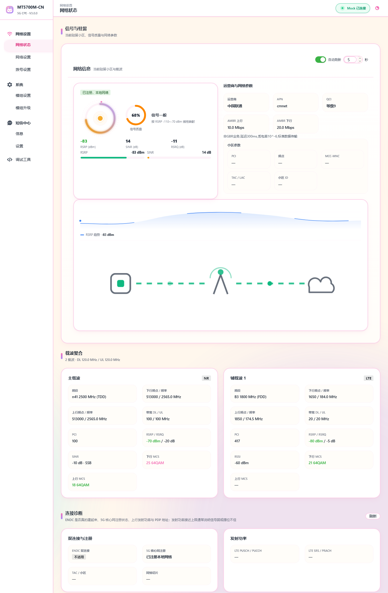
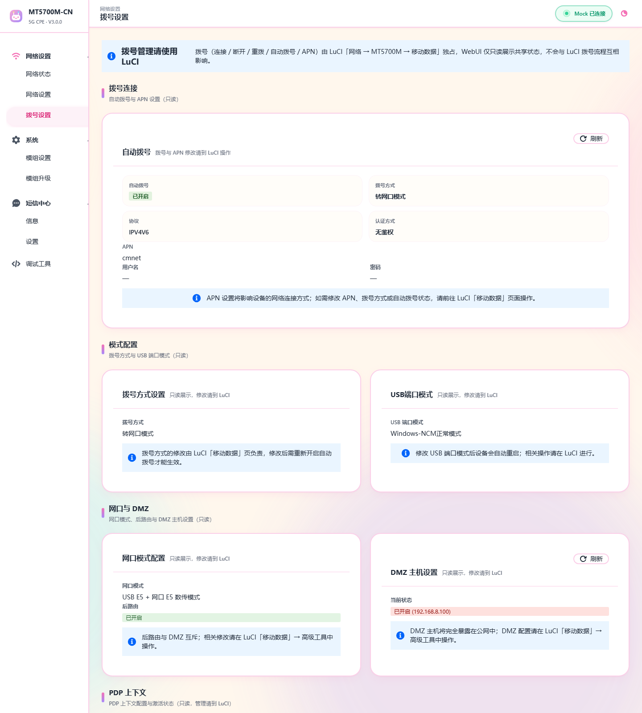
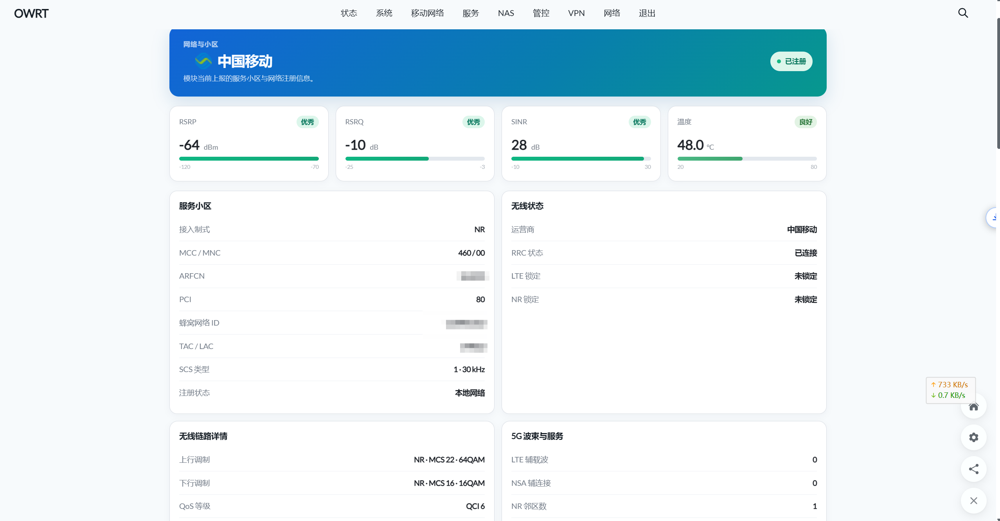
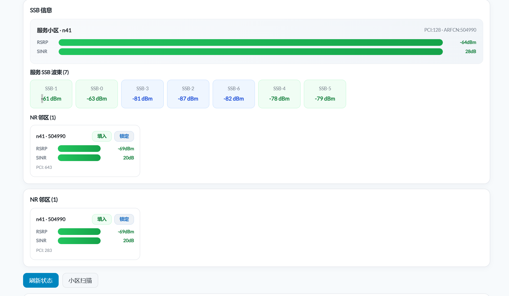

> [!WARNING]
> **⚠️ 项目状态与工程边界提示**
>
> 🔧 本项目目前处于架构大版本演进与深度重构阶段（v2/v3 异步化架构落地完成，目前集中于协议规范严谨化与真机联调）：
> - 自动化测试现已覆盖 374 项 `cargo test` 及 10 项 `prove-*-parity.js` 前端逐字等价比对；
> - 真实硬件行为、极端边缘场景时序与各固件驱动兼容性仍在持续打磨测试中，建议在测试验证环境体验。

---

<div align="center">

# 🚀 MT5700M OpenWrt 控制中心

**面向移远 Quectel MT5700M-CN 5G 模组的高性能 LuCI 管理器与独立 WebUI 控制台**

[](https://github.com/LianXia233/luci-app-mt5700m/releases)
[](https://openwrt.org/)
[-DEA584.svg?style=flat-square&logo=rust)](mt5700webui-openwrt-server/at-webserver/)
[](mt5700webui-openwrt-server/semi-tcpweb/)
[](#-规范与工程标准)
[](LICENSE)

<p align="center">
  <b>单包双前端全栈交付</b>：LuCI 原生视图 + 现代化 React WebUI + Rust 高性能异步后端<br>
  纯内网运行 · 绝不上传隐私 · 零第三方 Rust 动态库依赖 · 毫秒级 SWR 读指令缓存闸门
</p>

</div>

---

## 📸 界面预览

系统同时提供内置于 OpenWrt 的 LuCI 传统视图与基于 React + Semi Design 开发的高颜值独立 Web 控制台（可通过 `http://<路由器IP>/5700/` 访问）：

| 📊 5G 总览看板 (`01-overview`) | 🌐 移动网络数据 (`02-mobile-data`) |
|:---:|:---:|
|  |  |
| **📡 基站与小区信息 (`03-network-cell`)** | **📶 5G NR SSB 束波探测 (`04-ssb-beams`)** |
|  |  |

---

## 🌟 核心特性与架构演进

| 架构维度 | 实现机制与核心优势 |
|:---|:---|
| 🦀 **单后端双前端架构 (Arch v2)** | 确立 Rust 后端 `at-webserver` 为**唯一的 AT 串口持有者**（`TIOCEXCL` 硬件独占），LuCI 走本地控制套接字，独立 WebUI 走 WebSocket 接入，彻底杜绝串口死锁与数据截断。 |
| ⚡ **SWR 读命令命令闸门 (v3.1+)** | 针对 MT5700 慢指令（如 `^NTXPOWER?` 单条耗时 11.6 秒）的痛点，在后端入口加设 **SWR 智能缓存闸门**：新鲜缓存秒级直回、过期缓存旧值即回并触发后台异步刷新，边际响应速度**提升 22.5 倍**。 |
| 🌐 **NCM 高速数据承载** | 原生基于 Linux 标准 `kmod-usb-net-cdc-ncm` 高速网卡驱动进行数据面拨号与路由对账，兼顾吞吐与低 CPU 开销。 |
| 🔒 **原生 Termios 无依赖控制** | 串口参数全量由 Rust 直接调用系统 `TCGETS` / `TCSETS` ioctl 初始化，**不再依赖 BusyBox `stty`**；规范处理 `VMIN=1`/`VTIME=0`，避免非阻塞空闲引发的 EOF 假死与 `EAGAIN` 误判。 |
| 📊 **读写严格隔离与 URC 解耦** | 写操作由 verbs 路由进行严格参数白名单校验；模组主动上报 URC 流（如 `^PDCPDATAINFO:`）由底层独立解析后推送至事件总线，前端开关不触碰底层数据链路。 |
| 🧪 **严格不可变性验证** | 自动化流水线执行 10 个 `prove-*-parity.js` 脚本逐字比对 UI 渲染产物，确保后端无论如何重构，前端呈现的视图细节均零偏差。 |

---

## 📋 规范与工程标准

| 属性维度 | 技术选型与实现规范 |
|:---|:---|
| **软件包名** | `luci-app-mt5700m`（单包内嵌 LuCI 前端、独立 WebUI 与 Rust 后端） |
| **适配硬件** | 移远 Quectel MT5700M-CN 5G 通信模组 |
| **数据面协议** | NCM 协议（基于 Linux 原生 `kmod-usb-net-cdc-ncm` 驱动） |
| **控制面通信** | Rust 后端独占 AT 串口，LuCI 走本地 Unix Domain Socket、WebUI 走 WebSocket |
| **双入口访问** | ① **LuCI 入口**：`调制解调器` → `MT5700M 管理`<br>② **独立 WebUI**：`http://<路由器IP>/5700/` |
| **时钟同步规范** | 复用系统 `sysntpd` / `chrony` 服务，插件仅读取状态与手动下发对时，不启动第二个常驻时钟守护 |
| **DNS 注入防线** | 仅操作 `MT5700M` 与 `MT5700Mv6` 专用接口，统一由 `dns.sh apply` 原子生效 |

---

## 🏗️ 异步化架构：后端命令闸门工作流

解决 LuCI 与独立 WebUI 并发访问时互相排队阻塞的物理机制：

```text
前端读指令 ──> 【后端命令闸门】 ──┬── 命中新鲜缓存 ──> 立即毫秒级返回 (零 AT 开销、零阻塞)
                                  │
                                  ├── 命中过期缓存 ──> 立即返回旧值 + 触发后台异步静默刷新 (SWR)
                                  │
                                  ├── 从未采集过 ────> 提交单飞后台采集 + 立即回显「采集中」
                                  │
                                  └── 业务写指令 ────> 直通 AT 仲裁器顺序调度
```

### 缓存闸门优化实测对比

| 评测维度与场景 | 改造前 (直接下发 AT) | 改造后 (SWR 缓存闸门) | 性能改善倍率 |
|:---|:---:|:---:|:---:|
| 单次读指令 `AT^DHCP?` | 0.32 s | **0.07 s** | **4.6x** 提升 |
| 10 次高频连续串行读取 | 2.03 s | **0.15 s** | **13.5x** 提升 |
| **边际处理斜率** | ~200 ms / 次 | **8.9 ms / 次** | **22.5x 极致提升** |
| 状态总览 `mt5700m-at status` | 0.296 s | **0.08 s** | **3.7x** 提升 |
| 4 Worker × 6 轮高并发轰炸 | 容易超时崩溃 | **24 ms / 次** | **零丢包 PASS** |

---

## 🧭 系统拓扑结构

双前端共用统一的后端服务通道，Rust 后端建立硬件排他锁（`TIOCEXCL`），从根本上避免传统脚本多进程抢占 TTY 引起串口暴毙：

<div align="center">
  
</div>

---

## 📂 仓库项目架构

```text
luci-app-mt5700m/
├── luci-app-mt5700m/            # OpenWrt 软件包（LuCI 前端 + ucode + init.d 守护脚本）
│   ├── htdocs/luci-static/resources/
│   │   ├── mt5700m/             # api.js / parser.js / components.js / style.css
│   │   └── view/mt5700m/        # 8 大视图（status/connection/network/sms/system...）
│   ├── root/                    # 运行时配置文件与服务启动脚本
│   └── Makefile                 # OpenWrt 编译规则
├── mt5700webui-openwrt-server/  # 独立服务与全功能 WebUI
│   ├── at-webserver/src/        # 核心 Rust 后端（纯 std 零第三方依赖）
│   │   ├── daemon.rs            # JSON-RPC / Control Socket / WS 组合接入根
│   │   ├── scheduler/           # SWR 缓存闸门 (gate.rs) 与 AT 仲裁器 (arbiter.rs)
│   │   ├── state/               # StateCache 状态缓存池与 EventBus 事件总线
│   │   └── modules/             # 13 个业务领域模块（commands/parser/state）
│   └── semi-tcpweb/             # 独立 Web 控制台（React 18 + Semi Design）
├── docs/                        # 异步架构设计 (async-architecture.md) 与 API 契约文档
└── scripts/                     # 前端等价证明脚本 (prove-*-parity.js) 与 CI 静态工具
```

---

## 🛠️ 安装与故障排查

### 1. 快速安装

```sh
# opkg 系统（OpenWrt 24.10 / ImmortalWrt）
opkg update && opkg install luci-app-mt5700m

# apk 系统（ImmortalWrt 25.x / SNAPSHOT）
apk add --allow-untrusted luci-app-mt5700m
```

安装完成后可通过以下入口访问：
- **LuCI 原生界面**：导航至侧边栏 **调制解调器** → **MT5700M 管理**；
- **独立 Web 控制台**：浏览器直接打开 `http://<路由器IP>/5700/`。

### 2. 常见故障自检速查

#### 现象 A：AT 命令全部超时 / 前端数据全空
- **自检方案 1**：执行原生探测工具（绕开守护进程与仲裁器，直击物理端口）：
  ```sh
  at-webserver probe
  ```
  *预期输出：5/5 项握手全部正常响应。*
- **自检方案 2**：检查当前 termios 设置，确认 cooked 标记已清除且波特率为 115200：
  ```sh
  AT_DEBUG_TERMIOS=1 at-webserver probe
  ```

#### 现象 B：页面提示未连接（`connected=0`）
`connected` 是 LuCI 前端的总闸门。注意：该状态代表**「AT 控制通道正常在线」**，并非指 network 模式下的 TCP 链路建立。
```sh
mt5700m-at status | grep -E '^connected=|^channel=|^at_port='
# 正常预期：connected=1 channel=serial at_port=/dev/ttyUSB2
```

---

## 💖 致敬与鸣谢

* 👤 **[FAN789](https://github.com/FAN789)** — 鼎桥 MT5700M 模组原版驱动与 LuCI 交互界面的最初奠基者
* 👤 **[LianXia233](https://github.com/LianXia233)** — 主导完成 Architecture v2 架构重构、SWR 缓存命令闸门设计与 React WebUI 整合
* 🐧 **[OpenWrt](https://openwrt.org/)** / **[ImmortalWrt](https://immortalwrt.org/)** — 开放强大的路由操作系统生态

---

> 📜 **开源许可**：本项目基于 [Apache License 2.0](LICENSE) 协议开源。
